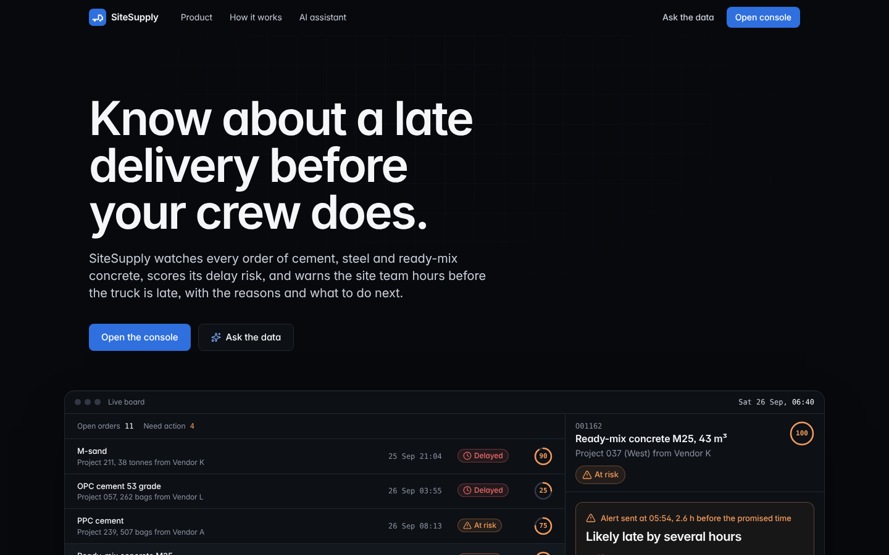
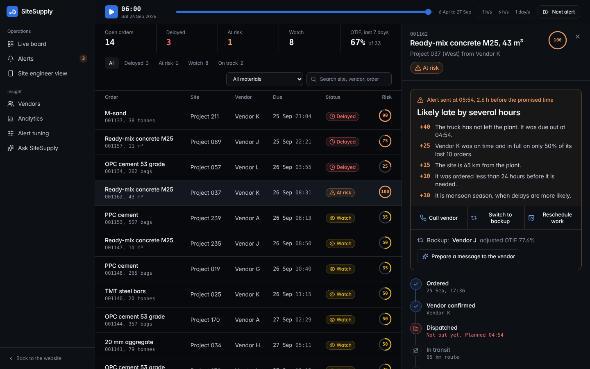
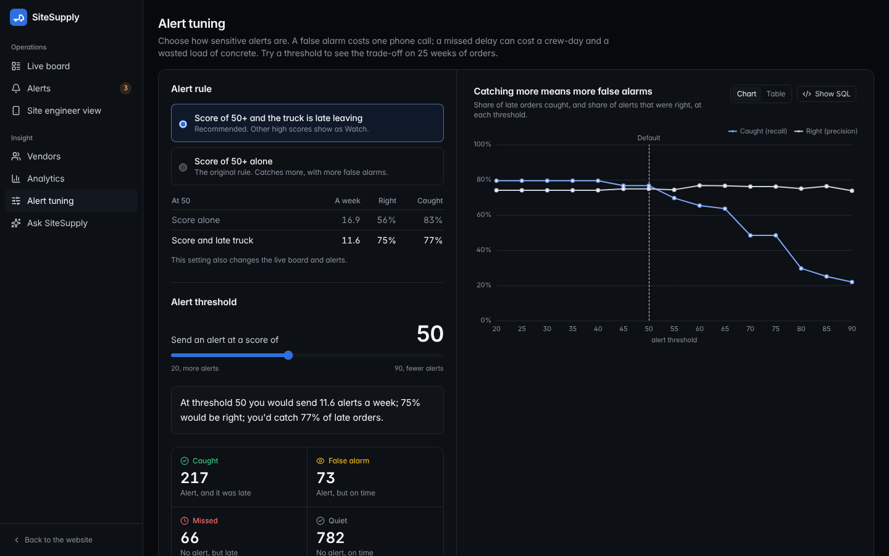
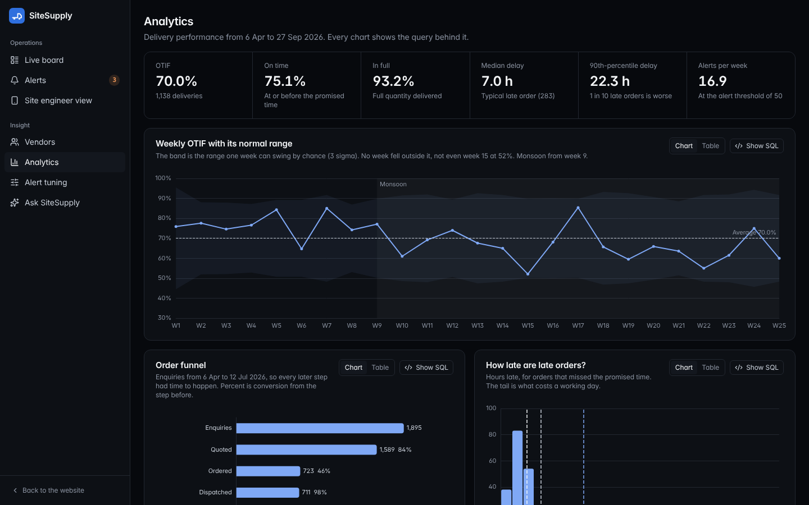
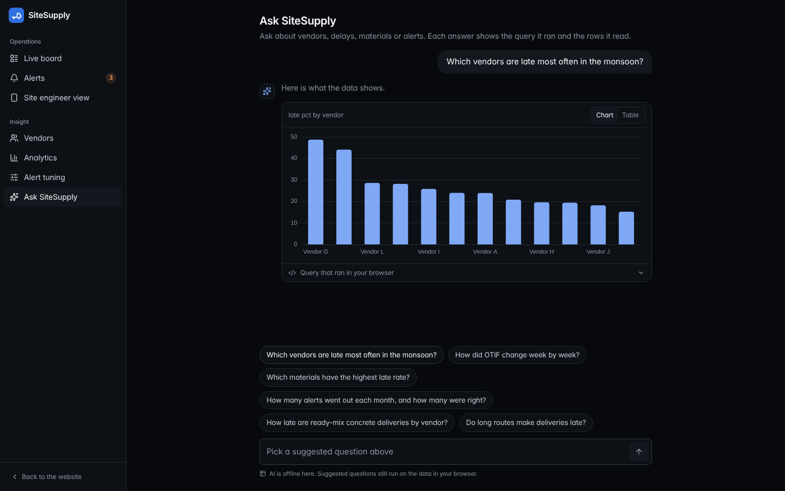
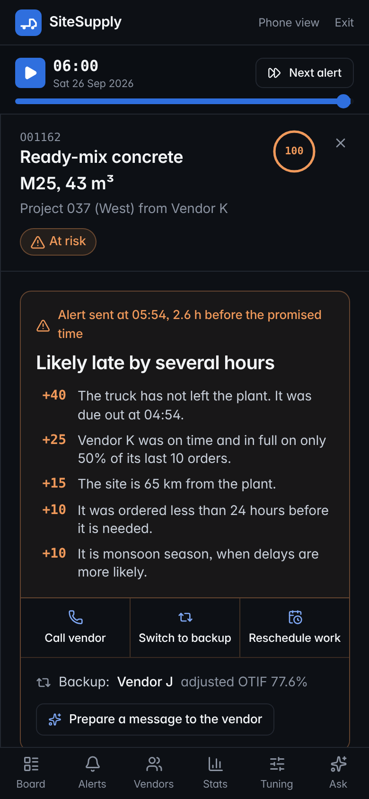
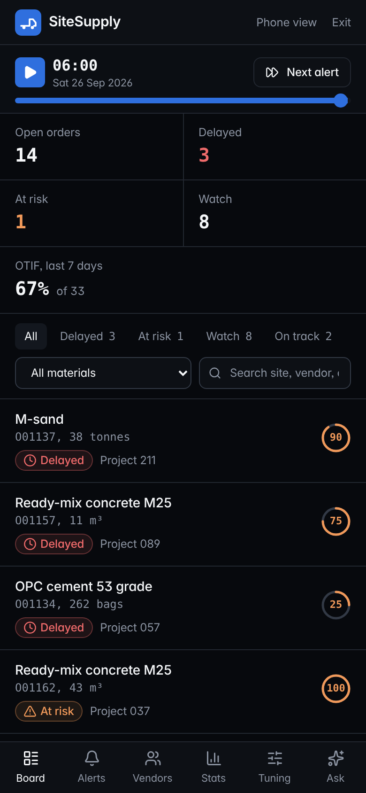

# SiteSupply

**Know about a late delivery before your crew does.**

Construction sites lose whole days when cement, steel or ready-mix concrete arrives late, and today the site team finds out only when the truck doesn't come. SiteSupply scores every material order for delay risk with simple rules anyone can check, and warns the site engineer hours before the promised time, with the reasons in plain words and three next steps: call the vendor, switch to a backup vendor, or move the crew to other work.

**Live:** [sitesupply-plum.vercel.app](https://sitesupply-plum.vercel.app/) · **Install on Android:** open the link in Chrome and tap *Install app*



> **All order data is sample data.** It was generated by a program (`scripts/make_sample_data.py`, seed 42) for 25 weeks, with some patterns planted on purpose. The project shows how a product manager would find and use those patterns; it does not claim real-world results. See [What's real vs sample](#whats-real-vs-sample).

## What's inside

| Page | What it does |
|---|---|
| **Landing page** (`/`) | The live board replays a morning from the simulated data: orders flip to *At risk* as the dispatch check runs, and the alert opens with its reasons. |
| **Live board** (`/console`) | Every open order with status and a 0–100 risk badge, filters, and a replay clock over the 25 weeks (play, speed, *Next alert*). |
| **Order detail and alert** (`/console/order/:id`) | Timeline, promised vs actual, the vendor's last 10 deliveries, why the score is what it is, and the alert with actions, a backup vendor and an AI-drafted message to the vendor. |
| **Site engineer view** (`/console/site`) | The same product in a 390×844 phone frame, for the site with the most orders. |
| **Vendors** (`/console/vendors`) | Sortable scorecard with raw OTIF, 95% Wilson range and adjusted (shrunk) OTIF, a shrinkage playground, and price vs reliability. |
| **Analytics** (`/console/analytics`) | KPIs, weekly OTIF on a control chart with monsoon shading, funnel, delay histogram, materials, season. Every chart has *Show SQL* (the query runs live in your browser) and a table view. |
| **Alert tuning** (`/console/tuning`) | Alert rule switch, threshold slider with confusion matrix, early watch vs dispatch alert, a rollout-test planner, and the odds-ratio chart. |
| **Ask SiteSupply** (`/console/ask`) | Ask a question in plain English: AI writes a read-only SQL query, it runs in your browser, and you get a chart, the rows and a short written answer. |
| **Case study** (`/case-study`) | The problem, users, nine insights with live charts, *which test and why*, the product documents and the data method. |

<p>
  
  
</p>
<p>
  
  
</p>
<p>
  
  
</p>

## Key insights (on sample data)

- **Two vendors cause half the late deliveries.** Vendors G and K handle 34% of orders but 52% of late ones, and win because they are about 5% cheaper. → Show reliability next to price.
- **Dispatch alerts are accurate but late.** They give a median of about 2.3 hours' warning (2.5 with the score-alone rule), and 20% of late orders leave on time and get stuck on the road. → Ship dispatch alerts first, then GPS tracking.
- **Most false alarms come from trucks that already left on time.** Requiring a late truck for a loud alert cut false alarms from 188 to 73 (75% of alerts right instead of 56%) while still catching 77% of late orders. → The default rule; validate it first on real orders.

## What's real vs sample

| Real | Sample |
|---|---|
| The product design, the scoring rules, the code and the statistics methods | Every order, vendor, customer and enquiry (synthetic, seed 42) |
| The PRD, user stories, roadmap and RICE reasoning (RICE inputs are my estimates) | All numbers on screen, which are computed from that sample data |
| The research plan | No user interviews yet: `docs/user_research.md` is an empty template |

Vendors are named Vendor A to Vendor L. No real company data, names or branding are used.

## Statistics used

Proportions (OTIF), median and 90th percentile, p-chart control limits, Wilson confidence intervals, empirical-Bayes shrinkage, chi-square test, logistic regression with odds ratios, precision and recall, sample size and power (Cohen's h), and cohort funnels. The in-browser versions are in `src/lib/stats.ts`, with tests that reproduce `data/stats_summary.json` to ±0.002.

## Run locally

```bash
npm install
npm run dev      # http://localhost:5173
npm test         # 26 tests, including the stats checks
npm run build
```

**AI assistant.** Copy `.env.example` to `.env.local` and add a free [Groq](https://console.groq.com) key as `GROQ_API_KEY`. On Vercel, add the same variable under *Project settings → Environment variables*. Without a key, the suggested questions still run on the data, without the written answer. The key stays on the server (`api/ai.js`) and is never sent to the browser. The endpoint only runs three fixed tasks (write the query, write the answer, draft a vendor message) with prompts built on the server, only answers pages on the same site, and allows 20 requests per visitor every 10 minutes. Setting a spending limit on the Groq key is a good extra safety net.

**Install as an app.** The production build is a PWA: on Android, open the site in Chrome and choose *Install app*. It opens on the console and works offline.

## Reproduce the data

```bash
python scripts/make_sample_data.py && python scripts/analysis.py && python scripts/build_sqlite.py
```

## Docs

[PRD](docs/prd.md) · [User stories](docs/user_stories.md) · [RICE](docs/rice.md) · [Metrics tree](docs/metrics_tree.md) · [Roadmap](docs/roadmap.md) · [Competitive scan](docs/competitive_scan.md) · [User research plan](docs/user_research.md) · [Metrics and SQL](docs/metrics.md) · [Design system](docs/DESIGN.md) · [Project explainer](docs/explainer.md)

## Tech

Vite, React 18, TypeScript, Tailwind CSS, React Router (hash), sql.js (SQLite in the browser), Apache ECharts, Framer Motion, react-markdown, Vitest, vite-plugin-pwa. Design language adapted from the Linear DESIGN.md in [VoltAgent/awesome-claude-design](https://github.com/VoltAgent/awesome-claude-design) (MIT). AI via Groq (GPT-OSS 120B, falling back to GPT-OSS 20B).

## Author

**Lakshay Malik** · [GitHub @Lakshayx007](https://github.com/Lakshayx007)
