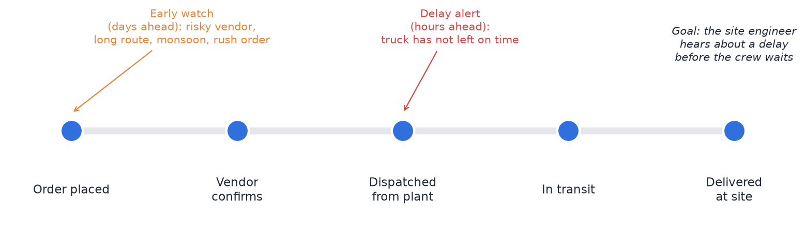
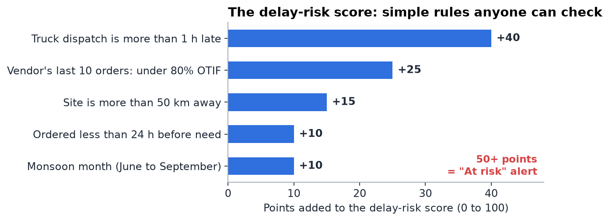
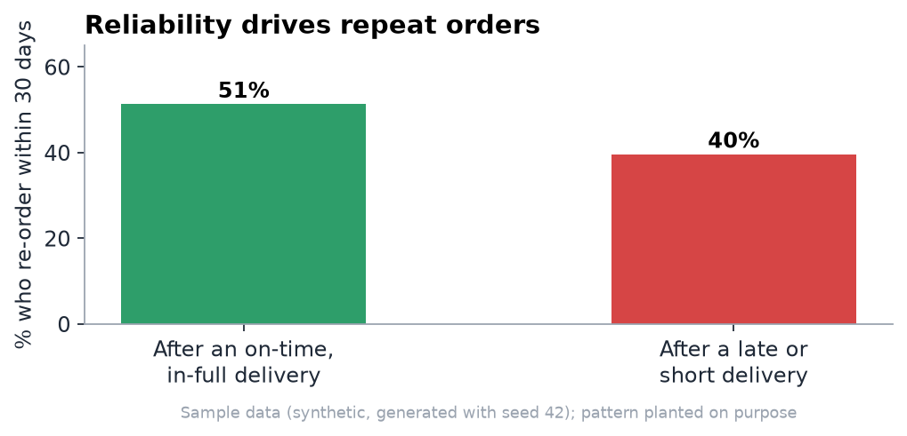
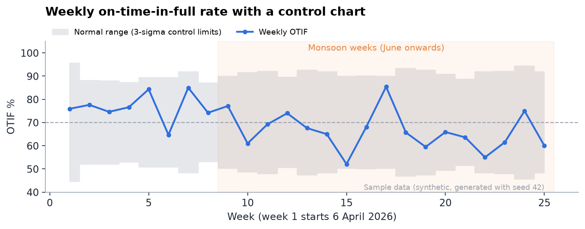
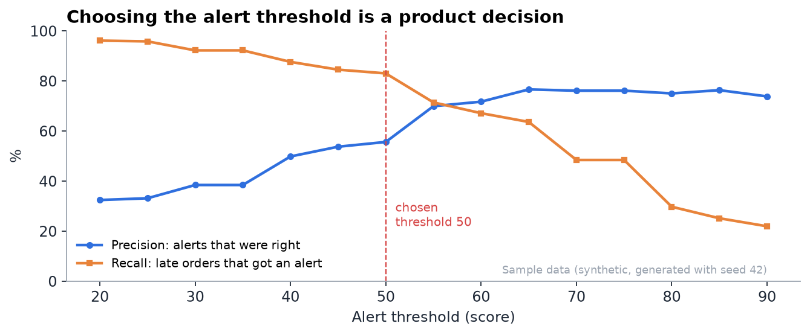
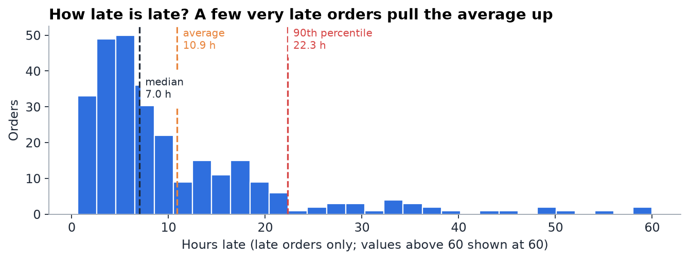
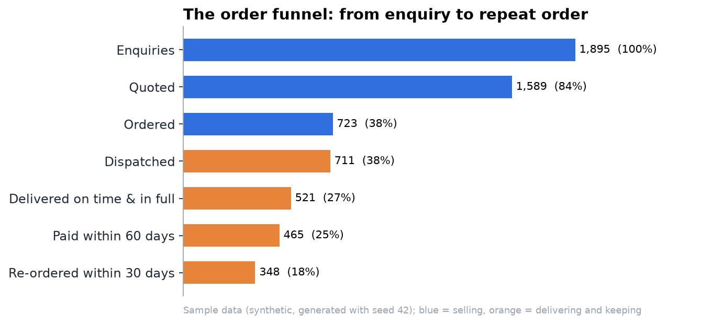
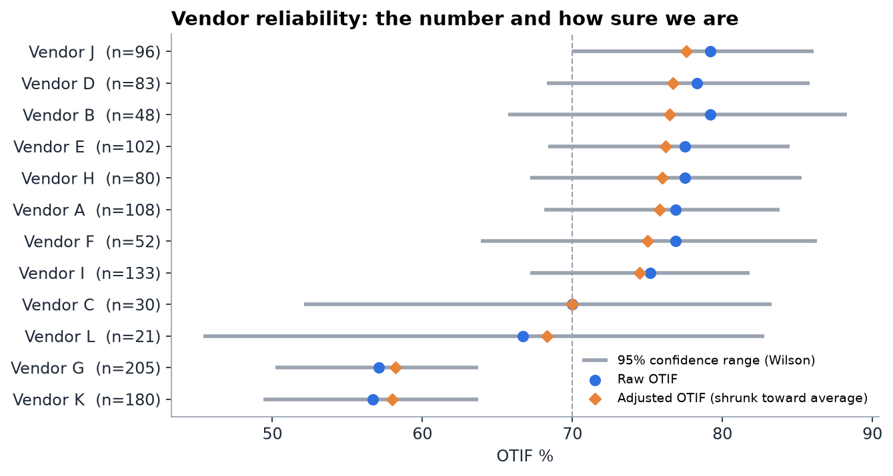
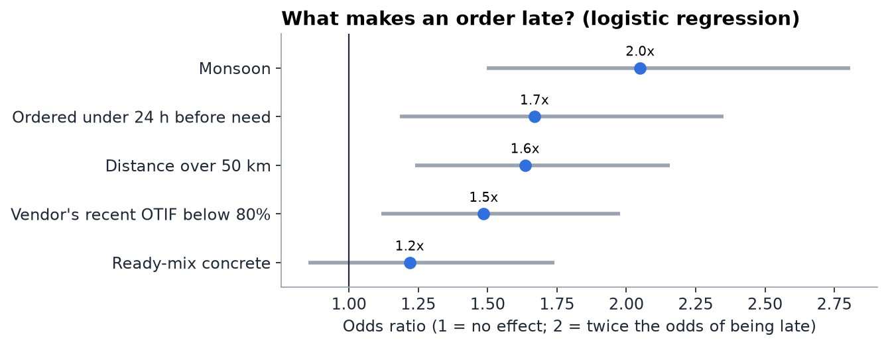

# In one paragraph

SiteSupply is a product that warns a construction site **before** a material delivery turns up late, so the site team can act instead of waiting. It watches every order of cement, steel, ready-mix concrete, sand and aggregate. When an order looks risky, it says why in plain words and suggests what to do: call the vendor, switch to a backup vendor, or move the crew to other work. The project is built the way a product manager would build it. It has a problem story, user types, a PRD with user stories, a working website, a metrics dashboard, and a statistics section that explains every number.

**An honest note before anything else.** All the order data in this project is **sample data that I generated with a computer program** (seed 42). Some patterns were planted on purpose, for example two unreliable vendors and more delays in the monsoon. The project shows **how a product manager would find and use these patterns**. It does not claim real-world results. When you talk about it, always say "on sample data".

# 1. The problem, as a story

Ravi is a site engineer on a 20-floor residential project in Bengaluru. Tomorrow at 9 am he has a slab pour planned. Twenty workers, a pump and a crane are booked. The ready-mix concrete truck is supposed to arrive at 8:30.

At 8:30 nothing arrives. Ravi calls the vendor. The phone is busy. At 9:15 he finds out the truck only left the plant at 8:45 and is stuck in traffic 40 km away. The crew waits. The pump is paid for by the hour. And ready-mix concrete cannot wait forever: a common rule of thumb from India's ready-mix code (IS 4926) is that transit should stay within about **2 hours** of mixing in normal weather, and less in hot weather. A late truck can mean a wasted load.

The painful part is that **the delay was visible earlier**. The truck had not left on time. The vendor had been late on several recent orders. It was monsoon season and the site was far away. Nobody put these signals together and told Ravi in time.

**SiteSupply's job is to put those signals together and tell Ravi early.**

{width=6.3in}

# 2. Why this matters to a company like ArisInfra

ArisInfra runs a digital platform for buying construction materials. In FY26 it reported revenue of about ₹1,067 crore, more than 3,400 customers with about 82% repeat orders, and more than 2,200 vendors. For a business like this, **reliability is the product**. A builder comes back if materials arrive on time and in full. A builder leaves if the platform's vendors let them down.

The standard way to measure this is **OTIF: On Time In Full**. It is the share of orders delivered at the promised time *and* in the full quantity ordered:

> OTIF = orders delivered on time and in full ÷ all delivered orders

SiteSupply is a feature that a platform like ArisInfra could add to protect OTIF and therefore repeat orders.

# 3. Who the users are

| User | What they are trying to do | What hurts today |
|---|---|---|
| **Site engineer** (main user) | Keep the day's work running | Finds out about delays only when the truck doesn't come; crew sits idle |
| **Procurement manager** at the builder | Buy at a fair price from vendors who deliver | Can't see which vendors are actually reliable; choices made on price alone |
| **Vendor dispatcher** | Load and send trucks on time | Gets angry calls after the fact; no early nudge |
| **Platform operations / category manager** | Keep OTIF high across thousands of orders | Problems show up in monthly reports, too late to fix |

The project focuses on the **site engineer**, because they feel the pain first and most. The other three users get supporting screens.

# 4. What we are building: the website

The website has two halves. One half is **the product itself** (what a site engineer would use on a phone). The other half is **the product manager's work**: dashboards, insights, statistics and documents. Together they show both "I can design a product" and "I can think like a PM".

**Product half (the demo):**

1. **Orders list.** Every order with material, quantity, site, vendor, promised time, a status chip (On track, Watch, At risk, Delayed, Delivered) and a risk badge. Filters for site, status and material.
2. **Order detail.** A timeline (Ordered → Vendor confirmed → Dispatched → In transit → Delivered), promised versus expected arrival, and the vendor's recent record.
3. **Delay alert.** Shows the risk score, **the reasons in plain words**, and suggested actions: call the vendor, switch to a backup vendor, or reschedule the work.
4. **Vendor scorecard.** Each vendor's OTIF, how sure we are about that number, average delay and order count.

**PM half (the thinking):**

5. **Operations dashboard.** OTIF by week, the order funnel, results by material, and monsoon versus dry season.
6. **Insights.** Eight short cards. Each has one chart, what it shows, and **the product decision it leads to**.
7. **Stats lab.** Interactive pieces: an alert-threshold slider, a sample-size calculator for A/B tests, and a "small sample" explainer for vendor scores.
8. **Product documents.** The PRD, user stories, RICE prioritisation, the metrics tree, the roadmap and the user research plan.
9. **Method and data.** How the sample data was made, what was planted, and the project's limits.

Every number on the dashboard has a **"Show SQL"** button that shows the query behind it and runs it in the browser on the sample data.

# 5. How the delay-risk score works

We deliberately use **simple, visible rules** instead of a black-box model. A site engineer has to trust an alert before they act on it. They will trust it more if they can see why it fired.

{width=6.3in}

Each order starts at 0 points. Points are added for each warning sign. At **50 points or more**, the order is marked **At risk** and an alert goes out. The alert always lists the reasons, for example: *"The truck has not left yet: dispatch is 2 hours late (+40). This vendor was on time and in full on only 6 of its last 10 orders (+25). Score 65: At risk."*

**Two warnings, not one.** The project tests the score at two moments:

- **Early watch, when the order is placed.** The truck hasn't moved yet, so only the vendor's record, distance, rush and season are known. This gives **days** of warning, but it is often wrong.
- **Delay alert, around dispatch time.** Now we know whether the truck left on time. This is much more accurate but gives only **hours** of warning.

This trade-off between early warning and accurate warning is one of the main product insights (see section 7).

# 6. The data

| Table | What is in it | Size |
|---|---|---|
| orders | Every order with timestamps (ordered, promised, planned and actual dispatch, delivered), quantity ordered and delivered, distance, risk score and alert | 1,158 orders (1,138 delivered, 20 cancelled) |
| enquiries | Every enquiry, and whether it got a quote and became an order | 3,166 |
| vendors | 12 vendors (Vendor A to Vendor L), the materials they supply and a price index | 12 |
| customers | 300 builders and contractors, one project site each | 300 |
| materials | OPC cement, PPC cement, TMT steel, ready-mix concrete, 20 mm aggregate, M-sand | 6 |

The data covers **25 weeks, 6 April to 27 September 2026**. That includes the monsoon months (June to September).

**What was planted on purpose:**

- Vendors **G and K** are unreliable and about 5% cheaper, so they keep winning orders.
- Delays are more likely **in the monsoon**, on **long routes (over 50 km)**, for **rush orders (under 24 hours' notice)**, and a little more for **ready-mix concrete**.
- **Customers order less for a month after a late or short delivery.**
- Vendor L is **new**: it joins in August and has few orders.

**Why plant patterns?** It lets us check whether our methods find what we know is there. It's like testing a metal detector on a beach where you buried the coins yourself. In the interview, say so openly. It shows you understand the difference between a method and a finding.

# 7. Product manager insights

These are the heart of the project. Each insight follows the same pattern: **what the data shows → what it means → what I would decide.** All numbers are on sample data.

## Insight 1: reliability drives repeat orders, so OTIF is the right north star

{width=6.3in}

After an on-time, in-full delivery, **51%** of customers ordered again within 30 days. After a late or short delivery, only **40%** did (694 and 278 deliveries; the difference is statistically significant, p ≈ 0.001). This pattern was planted, but it is exactly the logic a real platform lives by.

**Decision:** make the north-star metric *monthly value of orders delivered on time and in full*. Growth only counts if it is reliable growth.

## Insight 2: two vendors cause half the problem, and they win because they are cheaper

Vendors G and K handle **34% of orders** but cause **52% of late deliveries**. Their OTIF is about **57%**, against **77%** for everyone else. They stay busy because they are about 5% cheaper.

**Decision:** show procurement managers a **reliability score next to the price** when they choose a vendor, and give vendors their own scorecard so they can improve. Price alone hides the true cost of a late truck.

## Insight 3: one bad week is mostly noise; the monsoon is a real shift

{width=6.3in}

Weekly OTIF swings a lot. It dropped to **52% in week 15**, but that is still inside the normal range for a week of about 45 orders. The real change is the season. OTIF was **76% before the monsoon** and **66% during it**, and the late rate rose from **16.5% to 29.7%**. That difference is about 13 percentage points (95% confidence range 8 to 18 points), and very unlikely to be chance.

**Decision:** don't react to single bad weeks. Build a **monsoon playbook** instead: bigger time buffers for promised slots, earlier dispatch, and backup vendors lined up before June.

## Insight 4: the alert threshold is a product decision, not a technical one

{width=6.3in}

At the chosen threshold of **50**, alerts catch **83% of late orders**, and **56% of alerts turn out right**. That is about **17 alerts a week**. Raising the threshold to 55 makes alerts more often right (70%), but they catch only 71% of late orders.

**Decision:** a false alarm costs one phone call. A missed delay can cost a crew-day and a wasted load of concrete. Because missing a delay is so much worse, keep the threshold at 50. Watch **% of alerts acted on**: if people start ignoring alerts, that is alert fatigue, and the threshold should go up.

## Insight 5: dispatch alerts come late; early warnings come early but are often wrong

The delay alert at dispatch time gives a median of only **2.5 hours'** warning, and **20% of late orders** leave the plant on time and get stuck on the road, so a dispatch-based alert can't see them at all. The early watch at order time gives about **90 hours** of warning, but it is right only **30%** of the time. The overall late rate is 25%, so that is only a little better than guessing.

**Decision:** this sets the **roadmap**. Version 1 ships the dispatch alert, which is accurate and useful. Version 2 adds **live GPS tracking** to catch delays on the road. The early watch is used softly, as a "keep an eye on this" label, not a loud alert.

## Insight 6: the long tail matters more than the average

{width=6.3in}

A typical late order is about **7 hours** late (median). The **average is 10.9 hours**, pulled up by a few very late orders, and **1 in 10 late orders is more than 22 hours late**. Those very late orders are the ones that cost a full working day.

**Decision:** report the **median and the 90th percentile**, not the average. Set a separate goal for the tail: "no order more than 24 hours late without a backup plan".

## Insight 7: where the funnel leaks

{width=6.3in}

Of **1,895 enquiries**, 84% got a quote, but only 38% became orders. After that, 521 were delivered on time and in full, and 348 led to a repeat order within 30 days. The biggest drop is **quote to order**, which is a pricing and sales problem. The biggest drop on the delivery side is **dispatched to delivered on time and in full**, and that is the one SiteSupply attacks.

**Decision:** stay focused. SiteSupply owns the delivery part of the funnel. The quote-to-order drop is a separate problem for another team, and a PM should say so out loud.

## Insight 8: you can't A/B test this at small volume

To check whether alerts really raise on-time delivery from 75% to 80%, a normal A/B test needs about **1,089 orders in each group**. At 45 orders a week, that would take **48 weeks**. Even to detect a bigger jump of 8 points, you would need about 18 weeks.

**Decision:** at real platform scale, with thousands of orders a week, a test like this takes days. At small scale, use a **switchback** or **staggered rollout** (turn the feature on site by site and compare before and after), or accept that you can only detect big effects. Knowing this before launch is a sign of a good PM.

# 8. The statistics, explained simply

Each method below has four parts: what it is, why it's used here, the example from the data, and a one-line way to say it in an interview.

**1. Proportions and OTIF.** A proportion is a count divided by a total. *Here:* 70% of delivered orders were on time and in full; 75% were on time and 93% were in full. *Say:* "OTIF combines two promises, time and quantity, so it's stricter than either on its own."

**2. Median, average and 90th percentile.** The median is the middle value. The average adds everything and divides. The 90th percentile is the value that 90% of orders are below. *Here:* median delay 7 hours, average 10.9 hours, 90th percentile 22.3 hours. *Say:* "Delays are skewed, so I use the median for the typical case and the 90th percentile for the painful tail."

**3. Control chart (p-chart).** A chart of a weekly rate with a "normal range" band around the average. The band is wider when a week has fewer orders. Points outside the band are unusual; points inside are probably noise. *Here:* no week fell outside the band, even the 52% week. *Say:* "A control chart stops the team from over-reacting to one bad week."

**4. Confidence interval (Wilson method).** A range that probably contains the true value. Small samples give wide ranges. The Wilson method behaves well for percentages near 0% or 100% and for small counts. *Here:* Vendor L shows 67% OTIF, but on only 21 orders, so the true value could be anywhere from about 45% to 83%. *Say:* "Every vendor score comes with how sure we are."

{width=6.3in}

**5. Shrinkage (empirical Bayes).** Pull small-sample scores toward the overall average, in proportion to how little data there is. It's like a cricket batting average: one innings of 100 doesn't make someone a great batter. We add "20 orders' worth" of the average vendor to every vendor's record. *Here:* Vendor L's 67% on 21 orders becomes about 68%. Vendor G's 57% on 205 orders hardly moves. *Say:* "Shrinkage stops a new vendor with three lucky orders from topping the leaderboard."

**6. Comparing two groups (chi-square test and difference in rates).** These check whether a difference between two groups is bigger than chance would produce. The **p-value** is the chance of seeing a gap this big if there were really no difference. *Here:* the late rate was 29.7% in the monsoon against 16.5% in the dry season; p is less than 0.001, and the difference is 8 to 18 points. *Say:* "The monsoon effect is real, not noise, and I quote it as a range."

**7. Logistic regression and odds ratios.** A model that estimates how much each factor changes the odds of an order being late, **while holding the other factors fixed**. An odds ratio of 2 means twice the odds; 1 means no effect.

{width=6.3in}

*Here:* monsoon about **2 times**, rush orders about **1.7 times**, long distance about **1.6 times**, and a vendor with a poor recent record about **1.5 times** the odds. The model roughly recovered the planted effects. Ready-mix concrete's small planted effect (1.2 times) **was not statistically clear**. That is a useful lesson: with about 1,100 orders you can't reliably detect small effects. We left "dispatch late" out of this model on purpose, because it is a symptom of a delay, not a cause. *Say:* "I used the regression to check that the rules in my score point the right way, and to see which ones matter most."

**8. Precision and recall.** Precision: of the alerts we sent, how many were right? Recall: of the late orders, how many did we warn about? Raising one usually lowers the other. *Here:* 56% precision and 83% recall at threshold 50. *Say:* "I picked the threshold from the cost of a missed delay versus the cost of a false alarm."

**9. Sample size and power.** Before an experiment, work out how many orders you need to reliably see an effect of a given size. *Power* is the chance of detecting a real effect, usually set to 80%. *Here:* 1,089 orders per group to detect a 5-point gain from a 75% base. *Say:* "I sized the test before launch and found a classic A/B test was too slow, so I chose a staggered rollout."

**10. Funnel conversion and cohorts.** A funnel counts how many people reach each step. A cohort is a group that started in the same period and is followed over time. *Here:* enquiries from 6 April to 12 July, so every later step had time to happen. *Say:* "I used a fixed cohort so recent enquiries that hadn't had time to convert didn't drag the funnel down."

# 9. The product manager documents

**The PRD in short.**

- **Problem:** site teams learn about late deliveries too late to act.
- **Goal:** warn early enough that the team can do something.
- **Non-goals:** pricing, payments and the vendor's own logistics.
- **Success metrics:**
    - OTIF rate.
    - Warning lead time in hours.
    - Alert precision.
    - % of alerts acted on.
- **Guardrails** (metrics that must not get worse):
    - Vendor acceptance rate.
    - Cost per order.
    - Alerts per user per week (alert fatigue).

**Three of the eight user stories, with acceptance criteria:**

1. *As a site engineer, I want to be warned when a delivery is likely to be late, so that I can re-plan the crew.* **Given** an order whose score reaches 50, **when** the score is updated, **then** I get an alert within 5 minutes showing the reasons and three actions.
2. *As a procurement manager, I want to see each vendor's reliability next to their price, so that I don't pick a cheap vendor who is always late.* **Given** I am choosing a vendor, **when** I view the quote list, **then** each vendor shows adjusted OTIF and its confidence range.
3. *As an operations manager, I want weekly OTIF on a control chart, so that I react to real changes and not to noise.* **Given** the dashboard, **when** a week falls outside the normal range, **then** it is highlighted with the orders behind it.

**RICE prioritisation.** RICE scores each feature as Reach × Impact × Confidence ÷ Effort. The inputs are **my own estimates**, which is normal for RICE. Reach is orders affected per quarter, about 590 at the sample volume.

| Feature | Reach | Impact | Confidence | Effort (person-weeks) | RICE score |
|---|---|---|---|---|---|
| Delay alert at dispatch | 590 | 2 | 80% | 3 | **315** |
| Vendor reliability scorecard | 590 | 1 | 80% | 2 | **236** |
| Early watch at order time | 590 | 1 | 50% | 2 | **148** |
| Live GPS tracking | 590 | 2 | 70% | 10 | **83** |
| Photo proof of delivery (quantity disputes) | 590 | 0.5 | 80% | 3 | **79** |
| Backup-vendor suggestion on alert | 220 | 2 | 50% | 4 | **55** |

**The metrics tree:**

- **North star:** monthly value of orders delivered on time and in full.
- **Inputs that drive it:**
    - Dispatch punctuality.
    - Vendor mix (share of orders going to reliable vendors).
    - Alert precision and lead time.
    - % of alerts acted on.
- **Guardrails:**
    - Cost per order.
    - Vendor acceptance rate.
    - Alerts per user per week.

**Roadmap:**

- **MVP:** dispatch alerts, vendor scorecard and the dashboard.
- **v2:** GPS tracking, backup-vendor suggestions and the early watch label.
- **v3:** an AI assistant that reads a project's material schedule and predicts shortages.

**User research plan.** Talk to five site engineers and contractors, using "The Mom Test" style of questions. For example: "Tell me about the last delivery that went wrong. What happened next? What did it cost you?" Don't ask "would you use an app?". The research page in the project is a **template**. Only fill it with real conversations.

# 10. How to present it in an interview

**60-second pitch:** "Construction sites lose whole days when materials arrive late, and today they find out only when the truck doesn't come. I built SiteSupply, a delay early-warning product for material orders. It scores each order with simple rules anyone can check: is the truck late leaving, is the vendor's recent record poor, is the route long, is it monsoon. When an order crosses the threshold, it alerts the site engineer with the reasons and next steps. I wrote the PRD and user stories, prioritised features with RICE, and built a dashboard on sample data. The most interesting finding was a product trade-off: dispatch-based alerts are accurate but give only about two and a half hours of warning, while order-time warnings give days but are often wrong. That shaped the roadmap: ship dispatch alerts first, then add GPS tracking."

**Questions to expect:**

- **"Is this real data?"** No. It is sample data I generated, with patterns planted so I could check my methods find them. The next step would be to validate the rules with real order history and user interviews.
- **"Why rules and not machine learning?"** Users need to trust and understand an alert before they act on it. Rules are also easy to change. I used logistic regression only to check that the rules point the right way.
- **"What's your north star and why?"** On-time-in-full order value, because reliability drives repeat orders and repeat orders drive a B2B marketplace.
- **"How would you know the feature works?"** Track OTIF, warning lead time, alert precision and % of alerts acted on. Use a staggered rollout, because a classic A/B test needs too many orders at small scale.
- **"What would you do differently?"** Talk to more site engineers before building, and test whether a WhatsApp alert works better than an in-app one.

# 11. Limits of this project

- All data is synthetic, so the findings demonstrate methods, not real-world facts.
- The planted effects were chosen by me, so the regression "finding" them is a test of the method, not a discovery.
- The cost of a delay is described in words, not in rupees. Real cost data would sharpen the threshold choice.
- There are no real user interviews yet. The research section is a plan and a template.

# Glossary

- **OTIF:** On Time In Full, the share of orders delivered at the promised time and in full quantity.
- **Ready-mix concrete (RMC):** concrete mixed at a plant and delivered by truck. It must be used within a limited time.
- **Dispatch:** the moment the truck leaves the vendor's plant or yard.
- **Lead time (of a warning):** how many hours before the promised delivery the alert arrives.
- **North star metric:** the one number that best captures the value a product creates.
- **Guardrail metric:** a number that must not get worse while you improve the north star.
- **PRD:** Product Requirements Document, a description of the problem, the users, what to build and how to measure success.
- **RICE:** Reach × Impact × Confidence ÷ Effort, a way to rank features.
- **Precision and recall:** how often alerts are right, and how many real problems they catch.
- **Confidence interval:** a range that probably contains the true value.
- **Shrinkage:** pulling small-sample numbers toward the average.
- **p-value:** the chance of seeing a result this extreme if there were really no effect.
- **Odds ratio:** how many times higher the odds of something are when a factor is present.

**Sources:** ArisInfra Q1 FY27 factsheet and FY26 results coverage (company figures); InfraLens summary of IS 4926 ready-mix concrete delivery checks (transit time guidance); DHL logistics glossary (OTIF definition). All order statistics come from the project's own sample data.
